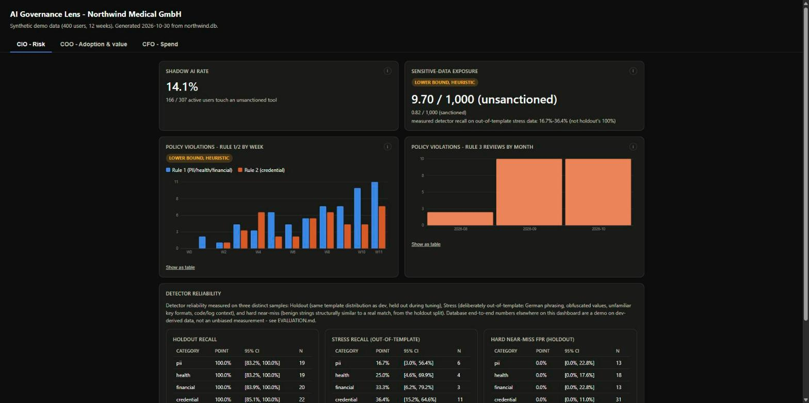
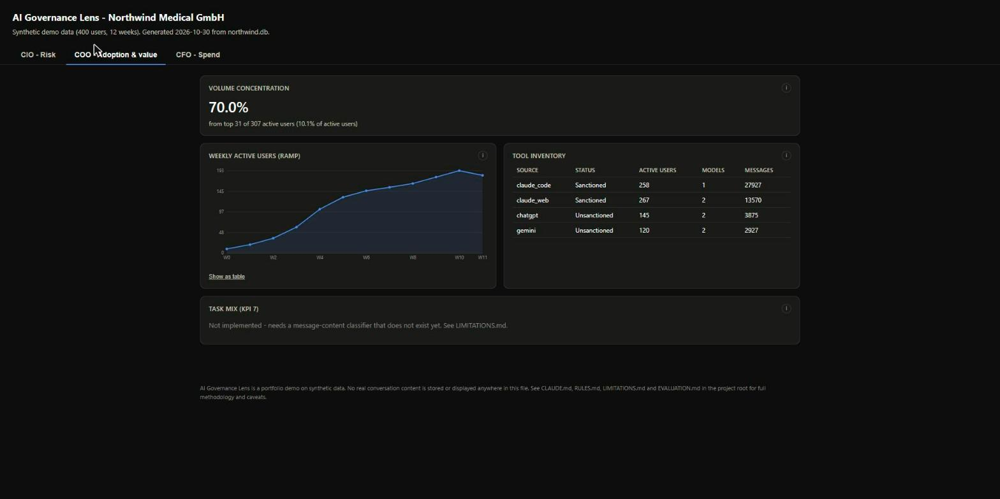
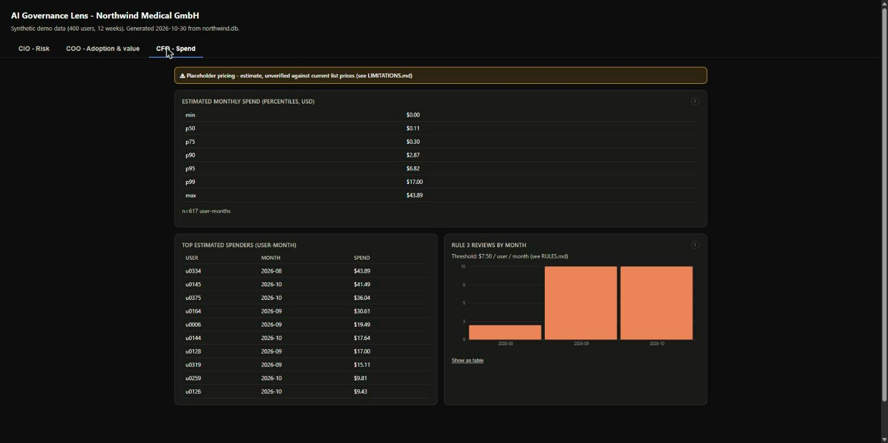

# AI Governance Lens

A portfolio project. Not a product, not a real company, not legal or financial advice.

## 1. The business problem

A CIO asks: *"Which AI tools are my people actually using, how much, with what kind of
data, at what cost — and does it comply with our policy?"* Today that answer is scattered
across ChatGPT, Claude, Gemini and coding agents, most of which expose no admin API to a
consumer-tier subscriber, so nobody has the full picture — this is "shadow AI." This
project is a prototype that turns raw usage exports into governance KPIs for a fictional
company, and is deliberately honest, on every screen, about what the underlying data can
and cannot prove.

## 2. The scenario

**Northwind Medical GmbH** — 400 employees, Germany (fictional). Invented policy for the
demo:

- **Sanctioned tools:** Claude (Team plan), Claude Code. Everything else — ChatGPT,
  Gemini — is unsanctioned.
- **Rule 1:** no customer or patient identifiers in any unsanctioned tool.
- **Rule 2:** no credentials or API keys in any tool, sanctioned or not.
- **Rule 3:** monthly AI spend per user above a threshold triggers a review.

Three personas this is built for: the **CIO** (risk and cost), the **COO** (adoption and
value), the **CFO** (spend). See `RULES.md` for the precise, formal version of each rule.

## 3. The dashboard

One self-contained HTML file (`dashboard.html`), no server, no network calls, opens
offline. Three tabs, one per persona. Screenshots below are from the synthetic dataset
(400 users, 12 weeks) — dark mode, matching the viewer's OS theme.

### CIO — risk



### COO — adoption & value



### CFO — spend



## 4. The KPIs

Every tile on the dashboard carries this same table as an inline tooltip (click the ⓘ
icon). KPI 7 is listed separately in §6 — it is not implemented.

| KPI | Definition | Formula | Data source | Known bias | Decision it supports |
|---|---|---|---|---|---|
| **1. Tool inventory** | Distinct sources/models in use, active users per tool. | `COUNT(DISTINCT user_id)`, `COUNT(DISTINCT model)`, `COUNT(*)` grouped by source | `messages JOIN tools` | Only sees usage that reaches this pipeline — a tool with no export at all is invisible by definition. | Which tools need formal sanctioning or procurement review. |
| **2. Shadow AI rate** | Share of messages (and users) on unsanctioned tools. | `100 × unsanctioned_messages / total_messages` | `messages JOIN tools` | Counts messages, not conversations or intent — one off-policy message weighs the same as a sustained pattern. | Whether to prioritize migration/blocking of unsanctioned tools vs. policy communication. |
| **3. Adoption** (WAU, messages/user/week, concentration) | Weekly active users; share of volume from the top 10% of users. | `COUNT(DISTINCT user_id)` by week; top-decile message share | `messages` | Message-sending is the only activity signal — a user who reads without sending is invisible. Synthetic data reflects the generator's adoption-ramp model, not real usage. | Where to invest training/enablement; whether rollout is landing broadly or concentrated in a few power users. |
| **4. Sensitive-data exposure** | Flagged messages per 1,000, sanctioned vs. unsanctioned. **Lower bound, heuristic.** | `1000 × flagged_messages / total_messages` | `messages JOIN tools LEFT JOIN flags` | Detector recall is 100% on same-distribution holdout but only **16.7%–36.4%** on out-of-template stress data — see §5. Real exposure is very likely higher than shown. | Whether current monitoring coverage is sufficient before loosening restrictions on any tool. |
| **5. Policy violations** (count per rule, trend) | Rule 1/2: distinct flagged messages per rule, by week. Rule 3: user-months over threshold, by month. | `COUNT(DISTINCT message_id)` by rule/week (flags); `COUNT(*) WHERE spend >= threshold` by month | `flags JOIN messages`; `messages` + pricing table | Rule 1/2 inherit the same detector-recall caveat as KPI 4. Rule 3 is exact arithmetic, not pattern-matching, but depends on placeholder pricing and an invented threshold. | Trend-based triage — is the violation rate rising or falling after an intervention. |
| **6. Estimated cost** | Tokens × public list price per model. **Always labelled estimate.** | `SUM(token_count)/1000 × price_per_1k`, grouped by user+month | `messages` + a hardcoded pricing table | **Placeholder pricing** — illustrative, unverified against current list prices. `token_count` is itself a heuristic (`chars/4`). | Budget forecasting; whether per-user spend caps are needed. |
| **Rule 3 reviews** | Count of user-months crossing the $7.50/month threshold. | `COUNT(*) WHERE spend_usd >= 7.50`, by month | `messages` + pricing table; threshold from `RULES.md` | Threshold is an invented heavy-use-persona budget calculation, not negotiated policy. "Crossed the threshold" ≠ misconduct — legitimately heavy users (e.g. a developer living in a coding agent) are included by design. | Who to pull into a spend review conversation this month. |

## 5. What the detector can and cannot do

**Lead with this number, not the headline recall:** on a stress set built specifically to
be out-of-template — German-language phrasing, obfuscated/spaced values, key formats the
rules don't name (Stripe/Slack/JWT/OpenSSH), sensitive data inside code/log syntax — the
detector's recall is **16.7%–36.4%** across the four categories (n=3–11 per category;
Wilson 95% CIs are wide at this sample size, see `EVALUATION.md`). The "hard near-miss"
false-positive rate — benign strings deliberately shaped like a real match (an order
number shaped like an SSN, a sandboxed test IBAN) — measured **0.0%** on the holdout split,
but on a thin sample (n=13–31 per category), so that guarantee is not strong either.

**Why the holdout's 100% recall/precision is not a validation of the detector.** The
holdout corpus is drawn from the *same templates* as the dev corpus the detector was
tuned against — only the specific rows differ. Scoring 100% there mainly confirms the
regexes correctly match the shapes they were written to match; it says nothing about
performance on real-world text, which doesn't arrive pre-formatted to a known template.
The stress numbers above are the honest estimate of real-world performance, not the
holdout numbers. This is why every exposure/violation tile on the dashboard is badged
**"lower bound, heuristic"** and cites the stress range, never the holdout figure.

**What generalizes, what doesn't** (see `EVALUATION.md`'s scenario breakdown): credentials
embedded in code/log syntax (`API_KEY = "..."`) were caught reliably — assignment syntax
structurally matches the keyword+operator pattern regardless of surrounding code fencing.
German-language phrasing survives only when an English keyword ("SSN", "DOB", "password")
happens to be kept inline; fully native phrasing ("Patientin", "Geburtsdatum", "Passwort")
is missed entirely. Obfuscation (letter-spacing) and unfamiliar key formats are missed
almost completely — the rules require contiguous structural shapes.

This is a first-pass, shape-based rule set, built to establish an honest, measured
baseline — not a claim that regex is sufficient for production DLP.

## 6. Limitations (honest list — see `LIMITATIONS.md` for the full version)

- **Database end-to-end numbers are a demo on dev-derived data, not an unbiased
  measurement.** Every flag in `northwind.db` comes from running the frozen detector
  against either pattern-free filler text or snippets drawn from the same corpus split
  the detector was tuned on. The ~100% recall visible in the live database is an expected
  consequence of that, not a real-world performance claim — the real numbers are in §5
  and `EVALUATION.md`.
- **Placeholder pricing.** Model token prices are illustrative, not checked against
  current public list prices. Every cost figure on the dashboard carries a visible banner
  saying so.
- **KPI 7 (task mix) is not implemented.** It needs a message-content classifier that
  doesn't exist — building one now would mean fabricating categorization logic ahead of
  any measured accuracy. The dashboard shows this as a "not implemented" card, not a
  placeholder number.
- **The Rule 3 threshold ($7.50/user/month) is an invented budget calculation** anchored
  to a stated heavy-use persona, not negotiated company policy — needs real CFO/owner
  sign-off before any non-demo use.
- **The adoption ramp, activity-weight distribution, and "dev power user" cohort are
  generator assumptions**, not real Northwind usage data — there is no real Northwind.
- Real export formats for ChatGPT / Claude / Gemini have not been seen — the synthetic
  generator writes directly into the normalized schema, not through a parser. A real
  adapter (not built) would need actual sample exports.
- No `users` table, no task-category table, no legal-compliance claims anywhere in this
  codebase.

## 7. What I would need to run this in a real company

**Everything in this section is unverified and must be checked against current vendor
documentation before relying on it** — admin/compliance API availability and scope change
over time and are not something to take from training data as current fact.

- **ChatGPT (OpenAI):** an Enterprise/Team admin console with usage/audit export —
  verify current scope (does it expose per-message content, or only aggregate usage?).
- **Claude (Anthropic):** Team/Enterprise admin and usage APIs — verify current scope for
  conversation-level export vs. aggregate usage only.
- **Gemini (Google):** Workspace/Vertex AI audit logging — verify current scope and
  whether consumer-tier usage is visible to an org admin at all.
- **Consumer-tier tools in general:** most of "shadow AI" is, by definition, usage on
  plans with no admin API — this is the core problem statement in §1, not something an
  API integration can fully solve.
- **Legal/compliance framing:** EU AI Act and GDPR are referenced in this project only as
  *framing* for why a CIO would care, never as a specific legal claim about what the
  regulations require. **Verify current requirements with qualified legal counsel before
  making any compliance claim** — nothing here should be read as having done that.

## 8. How to run it

Three commands, from the project root:

```bash
python src/generate_synthetic_data.py   # builds data/synthetic/northwind.db (runs the
                                         # frozen detector inline to populate `flags`)
python src/build_dashboard.py           # renders dashboard.html from the DB + the
                                         # committed EVALUATION.json
```

Then open `dashboard.html` in any browser — no server needed, works with no network
connection.

(`pip install pytest` once, then `pytest tests/` to run the test suite — not part of the
3-command run path, but how the project is actually checked.)

## 9. 90-second demo script

1. **(10s)** Open `dashboard.html`. "This is a synthetic demo — 400 fictional employees,
   12 weeks, four AI tools. No real data anywhere in this file."
2. **(20s) CIO tab.** Point at Shadow AI rate (14.1%) and Sensitive-data exposure. "This
   tile is badged lower-bound, heuristic — click the ⓘ." Open the tooltip. "It says the
   measured detector recall on out-of-template data is 16.7–36.4%, not the 100% you'd see
   on the training-like holdout. That's deliberate — scroll down."
3. **(15s)** Scroll to Detector reliability panel. "Three separate measurements: holdout,
   stress, and a hard-near-miss false-positive check, each with a confidence interval and
   sample size. The dashboard never shows the flattering number without the honest one
   next to it."
4. **(15s) COO tab.** "Adoption ramped from 2.5% to 48.2% of the org over 12 weeks — most
   enterprise rollouts don't start at 100%, so neither does this model. Volume is
   concentrated: 10% of active users produce 70% of the traffic." Point at Task mix:
   "This one's honestly marked not implemented, with the reason, instead of a fabricated
   number."
5. **(20s) CFO tab.** Point at the placeholder-pricing banner. "Every cost number on this
   tab carries this — the prices are illustrative, not verified against current list
   prices." Point at Rule 3 reviews. "22 user-months crossed the review threshold this
   quarter (13 planted test cases, 9 organic) — some are legitimately heavy developers,
   not violations; the dashboard treats
   'crossed a threshold' and 'did something wrong' as different claims."
6. **(10s)** Close on README §5/§6: "Every number on this dashboard either has a
   confidence interval or a label telling you it's an estimate. That's the actual
   deliverable — not the dashboard, the discipline behind it."
